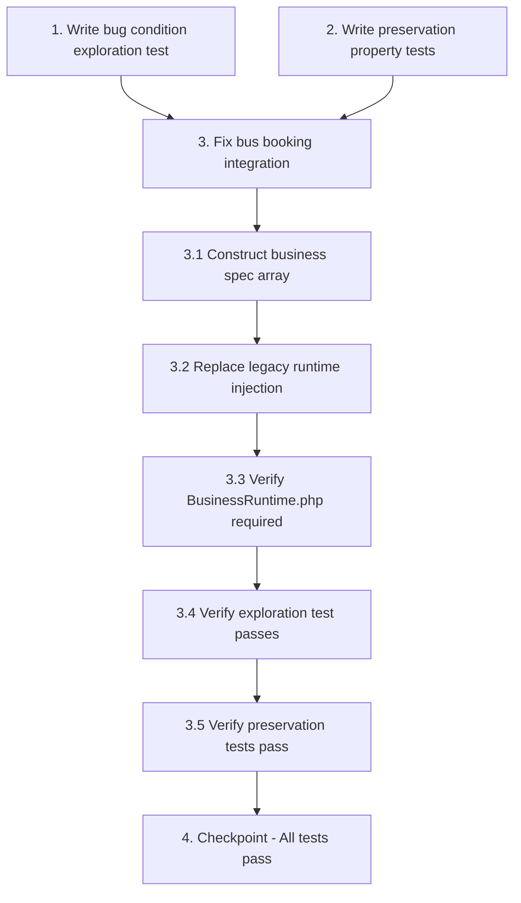

# Implementation Plan

## Overview

This implementation plan follows the exploratory bugfix workflow:
1. **Explore** - Write property-based tests BEFORE the fix to understand the bug (Bug Condition)
2. **Preserve** - Write property-based tests for non-buggy behavior (Preservation Requirements)
3. **Implement** - Apply the fix with understanding (Expected Behavior)
4. **Validate** - Verify the fix works and doesn't break anything

The fix modifies `AutoSiteGenerator::generate()` to inject the `BusinessRuntime` integration layer for bus booking sites, connecting the frontend `BusBookingWidget` to the backend `api/business-ops.php`.

---

## Tasks

- [x] 1. Write bug condition exploration test
  - **Property 1: Bug Condition** - Bus Booking Sites Missing Runtime Integration
  - **CRITICAL**: This test MUST FAIL on unfixed code - failure confirms the bug exists
  - **DO NOT attempt to fix the test or the code when it fails**
  - **NOTE**: This test encodes the expected behavior - it will validate the fix when it passes after implementation
  - **GOAL**: Surface counterexamples that demonstrate the bug exists
  - **Scoped PBT Approach**: Scope the property to bus booking generation requests with explicit bus-related inputs
  - Test implementation details from Bug Condition in design:
    - Generate a bus booking site using `AutoSiteGenerator::generate()`
    - Input: `company_name="City Express"`, `project_type="bus booking"`, `primary_purpose="online bus ticket booking"`
    - Assert the generated `index.html` contains `data-wc-biz-runtime` attribute (runtime injected)
    - Assert the generated `index.html` contains `window.WCBiz` definition (API object defined)
    - Assert the generated `index.html` contains `IS_BUS_BOOKING=(true)` (bus detection worked)
    - Assert the generated `index.html` contains reference to `api/business-ops.php` (backend connected)
  - Run test on UNFIXED code
  - **EXPECTED OUTCOME**: Test FAILS with assertion errors showing missing runtime elements (this is correct - it proves the bug exists)
  - Document counterexamples found:
    - Inspect generated HTML and note missing `data-wc-biz-runtime` script tag
    - Note that `window.WCBiz` is undefined
    - Note that `BusBookingWidget` HTML is present but disconnected
  - Mark task complete when test is written, run, and failure is documented
  - _Requirements: 1.7, 1.8, 1.9, 2.7, 2.8, 2.9_

- [x] 2. Write preservation property tests (BEFORE implementing fix)
  - **Property 2: Preservation** - Non-Bus Site Generation Unchanged
  - **IMPORTANT**: Follow observation-first methodology
  - Observe behavior on UNFIXED code for non-buggy inputs (non-bus sites)
  - Generate test sites with the UNFIXED `AutoSiteGenerator::generate()`:
    - Restaurant site: `company_name="Tasty Bites"`, `project_type="restaurant"`, `features="online ordering"`
    - Hotel site: `company_name="Grand Hotel"`, `project_type="hotel"`, `features="room reservations"`
    - Salon site: `company_name="Style Salon"`, `project_type="beauty salon"`, `features="appointment booking"`
  - Observe and record outputs for each:
    - Check for absence of `data-wc-live-bus-booking` attribute
    - Check for absence of `IS_BUS_BOOKING=(true)` in any scripts
    - Check for absence of `bus-seat-grid` or bus-specific HTML
    - Record presence/absence of generic form runtime features
  - Write property-based tests capturing observed behavior patterns from Preservation Requirements:
    - FOR ALL non-bus business specs (where `wc_business_requires_bus_booking()` returns false):
      - Assert generated HTML does NOT contain bus-specific elements
      - Assert generated HTML does NOT contain `IS_BUS_BOOKING=(true)`
      - Assert admin panel generation works identically
      - Assert entity seeding works identically
  - Property-based testing generates many test cases for stronger guarantees across different categories
  - Run tests on UNFIXED code
  - **EXPECTED OUTCOME**: Tests PASS (this confirms baseline behavior to preserve)
  - Mark task complete when tests are written, run, and passing on unfixed code
  - _Requirements: 3.1, 3.2, 3.3, 3.4, 3.7, 3.8, 3.9, 3.10, 3.11, 3.12_

- [x] 3. Fix bus booking frontend-backend integration

  - [x] 3.1 Construct business spec array after manifest generation
    - Location: `includes/AutoSiteGenerator.php` after line ~72 (after `$manifest` is built)
    - Add code to construct the business spec array from manifest data:
      ```php
      // Construct business spec for runtime injection
      $businessSpec = [
          'category' => $category,
          'slug' => $slug,
          'profile' => [
              'business_name' => $bizName,
              'domain' => $category,
              'description' => $purpose . ' ' . $uvp,
          ],
          'business' => [
              'category' => $category,
              'name' => $bizName,
          ],
          'entities' => $manifest['entities'] ?? [],
          'capabilities' => $manifest['capabilities'] ?? [],
      ];
      ```
    - Ensure all required fields are present for `wc_business_requires_bus_booking()` to detect bus booking sites
    - Verify `$category`, `$slug`, `$bizName`, `$purpose`, `$uvp`, and `$manifest` are all available at this point
    - _Bug_Condition: isBugCondition(input) where wc_business_requires_bus_booking(input.spec) == true AND business_runtime_inject_called(input) == false_
    - _Expected_Behavior: businessSpec array contains category, profile, entities, and capabilities needed for detection_
    - _Preservation: Non-bus sites will also have spec constructed but will not trigger bus runtime injection_
    - _Requirements: 2.7, 2.8, 2.9_

  - [x] 3.2 Replace legacy runtime injection call with current function
    - Location: `includes/AutoSiteGenerator.php` lines ~88-92
    - Remove existing legacy code:
      ```php
      // Inject Business Runtime & Safety Net
      if (function_exists('injectBusinessRuntime')) {
          $siteHtml = injectBusinessRuntime($siteHtml);
      }
      ```
    - Replace with current function call:
      ```php
      // Inject Business Runtime & Safety Net
      if (function_exists('business_runtime_inject')) {
          $siteHtml = business_runtime_inject($siteHtml, $businessSpec, $slug);
      }
      ```
    - Pass three parameters: `$siteHtml` (the generated HTML), `$businessSpec` (constructed in 3.1), `$slug` (site identifier)
    - The function will internally call `wc_business_requires_bus_booking($businessSpec)` to determine if bus runtime should be injected
    - _Bug_Condition: isBugCondition(input) where business_runtime_inject() was available but never called during generation_
    - _Expected_Behavior: business_runtime_inject() is called for ALL sites, but only injects bus features when detection returns true_
    - _Preservation: Non-bus sites receive generic runtime (forms/history) only, bus-specific code excluded_
    - _Requirements: 2.7, 2.8, 2.9, 3.1, 3.2_

  - [x] 3.3 Verify BusinessRuntime.php is already required
    - Location: `includes/AutoSiteGenerator.php` line ~17
    - Confirm this line exists: `require_once __DIR__ . '/BusinessRuntime.php';`
    - No code change needed, just verification that the dependency is loaded
    - This ensures `business_runtime_inject()` and `wc_business_requires_bus_booking()` are available
    - _Expected_Behavior: Function dependency resolution works correctly_
    - _Preservation: No change to existing require structure_
    - _Requirements: 2.7, 2.8_

  - [x] 3.4 Verify bug condition exploration test now passes
    - **Property 1: Expected Behavior** - Bus Booking Runtime Successfully Injected
    - **IMPORTANT**: Re-run the SAME test from task 1 - do NOT write a new test
    - The test from task 1 encodes the expected behavior (runtime present, window.WCBiz defined)
    - Generate a bus booking site using the FIXED `AutoSiteGenerator::generate()`
    - Run the exploration test from step 1 against the newly generated site
    - **EXPECTED OUTCOME**: Test PASSES with all assertions successful:
      - `data-wc-biz-runtime` attribute found in generated HTML
      - `window.WCBiz` object definition found in generated HTML
      - `IS_BUS_BOOKING=(true)` found in runtime script
      - `api/business-ops.php` reference found in OPS_API configuration
    - This confirms the bug is fixed for all bus booking site generation requests
    - _Requirements: 2.1, 2.2, 2.3, 2.4, 2.5, 2.6, 2.7, 2.8, 2.9, 2.10, 2.11, 2.12_

  - [x] 3.5 Verify preservation tests still pass
    - **Property 2: Preservation** - Non-Bus Sites Remain Unchanged
    - **IMPORTANT**: Re-run the SAME tests from task 2 - do NOT write new tests
    - Generate the same non-bus test sites (restaurant, hotel, salon) using the FIXED `AutoSiteGenerator::generate()`
    - Run preservation property tests from step 2 against newly generated sites
    - **EXPECTED OUTCOME**: Tests PASS with no bus-specific elements found:
      - No `data-wc-live-bus-booking` in generated HTML
      - No `IS_BUS_BOOKING=(true)` in any scripts
      - No `bus-seat-grid` or bus widget HTML
      - Admin panel generation identical
      - Entity seeding identical
    - This confirms no regressions for non-bus business types
    - Verify the fix is surgical - only affects bus booking sites
    - _Requirements: 3.1, 3.2, 3.3, 3.4, 3.5, 3.6, 3.7, 3.8, 3.9, 3.10, 3.11, 3.12_

- [ ] 4. Checkpoint - Ensure all tests pass
  - Run complete test suite (exploration test + preservation tests)
  - Verify all property-based tests pass
  - Generate sample bus booking site and perform manual verification:
    - Open generated `published/{slug}/index.html` in browser
    - Open browser console and verify `window.WCBiz` is defined
    - Check that `typeof window.WCBiz.api === 'function'`
    - Verify other methods present: `hold`, `create`, `cancel`, `pay`, `ticketQR`, `printTicket`, `gotoStep`
  - Generate sample non-bus site (restaurant) and verify no bus features present
  - If any test fails, return to implementation steps and debug
  - If questions arise about edge cases or behavior, ask the user for clarification
  - Mark complete when all automated tests pass and manual verification succeeds

---

## Task Dependency Graph



```json
{
  "waves": [
    {
      "name": "Wave 1: Exploration and Preservation Tests",
      "tasks": ["1", "2"],
      "description": "Write property-based tests to understand bug and baseline behavior before implementing fix"
    },
    {
      "name": "Wave 2: Implementation",
      "tasks": ["3.1", "3.2", "3.3"],
      "description": "Apply the fix by constructing business spec and calling runtime injection function"
    },
    {
      "name": "Wave 3: Validation",
      "tasks": ["3.4", "3.5"],
      "description": "Verify bug is fixed and no regressions introduced"
    },
    {
      "name": "Wave 4: Final Verification",
      "tasks": ["4"],
      "description": "Complete test suite and manual verification"
    }
  ]
}
```

**Dependency Explanation:**
- Tasks 1 and 2 (exploration and preservation tests) must be completed BEFORE implementation (task 3) to establish baseline understanding
- Task 3.1 (construct spec) must complete before 3.2 (use spec in injection call)
- Task 3.2 (replace function call) must complete before 3.3 (verify dependencies loaded)
- Task 3.3 must complete before 3.4 (verify fix works)
- Task 3.4 (bug fix verification) must complete before 3.5 (preservation verification)
- Task 3.5 must complete before final checkpoint (task 4)

---

## Notes

### Testing Approach

This bugfix uses **property-based testing (PBT)** for both exploration and preservation:

- **Exploration Test (Property 1)**: Scoped to bus booking generation requests. The test encodes the expected behavior (runtime injected) and will FAIL on unfixed code, confirming the bug exists. After the fix, it will PASS, validating the solution.

- **Preservation Test (Property 2)**: Generates many non-bus site types to ensure the fix doesn't cause regressions. Property-based testing provides stronger guarantees than manual unit tests by covering more of the input space.

### File Modifications

Only one file needs to be modified:
- `includes/AutoSiteGenerator.php` (lines 72-92 approximately)

No changes required to:
- `includes/BusinessRuntime.php` (already has detection and injection logic)
- `includes/BusBookingWidget.php` (already generates correct HTML)
- `api/business-ops.php` (already has working backend API)

### Root Cause

The bug exists because `AutoSiteGenerator::generate()` builds the complete site HTML but never calls `business_runtime_inject()` to connect the frontend widget to the backend API. The runtime injection function exists and works correctly - it's simply not being invoked during site generation.

### Fix Strategy

The fix is surgical and minimal:
1. Construct a business spec array from the existing manifest data
2. Call `business_runtime_inject($html, $spec, $slug)` before writing the final HTML
3. The function will detect bus booking sites internally and inject the runtime accordingly

This approach ensures non-bus sites remain completely unaffected while enabling the complete booking workflow for bus sites.
